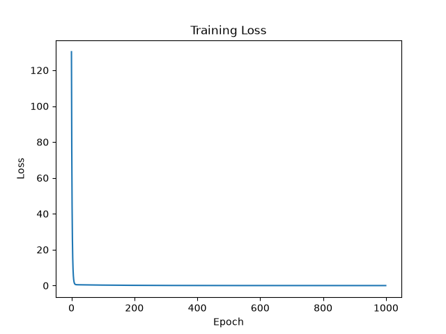
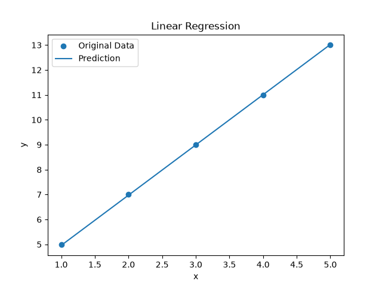

# PyTorch Linear Regression

## 1. Project Introduction

This project implements a simple linear regression model using PyTorch to learn the relationship:

\[
y = 2x + 3
\]

It demonstrates the basic workflow of training, evaluating, saving, and loading a PyTorch model.

## 2. Project Structure

```text
linear_regression/
├── train.py
├── predict.py
├── model.pth
├── loss.png
├── prediction.png
├── requirements.txt
├── README.md
└── .gitignore
```

## 3. Requirements

- Python
- PyTorch
- Matplotlib

Install dependencies:

```bash
pip install -r requirements.txt
```

## 4. How to Run

Train the model:

```bash
python train.py
```

Load the trained model and make predictions:

```bash
python predict.py
```

## 5. Results

The model learns parameters close to:

- Weight: 2
- Bias: 3

The final loss is close to zero.

### Training Loss



### Prediction Results



## 6. Key Concepts

- Tensor operations
- `nn.Linear`
- `nn.MSELoss`
- SGD optimizer
- Forward propagation
- Backpropagation
- Model saving and loading with `state_dict`
